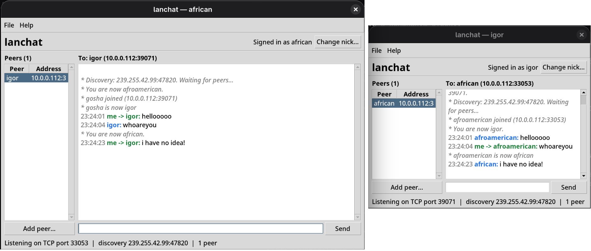

# lanchat

**English** | [Русский](README.ru.md)

A tiny peer-to-peer chat for devices on the same **Wi-Fi / LAN**. No server,
no internet, no accounts, no third-party packages — just the Python standard
library.

Devices find each other automatically with UDP multicast and send messages
directly to each other over TCP.

The package has two front ends: a terminal UI (`python3 -m lanchat`) and a
Tkinter GUI (`python3 -m lanchat.gui`). They share the same backend and can
chat with each other.

## Requirements

- Python 3.8+
- All devices on the same local network (same Wi-Fi router / LAN)

No `pip install` needed.

## Quick start

Start it on two (or more) devices:

```bash
python3 -m lanchat --nick alice     # on the first device
python3 -m lanchat --nick bob       # on the second device
```

Once running:

```
Signed in as alice  |  listening on port 57092
> /peers
Peers (1):
  [1] bob @ 192.168.1.23:57093
> /to bob
Now talking to bob (192.168.1.23:57093).
[bob]> hey bob, can you hear me?
```

### Tkinter GUI

Prefer a window? Start the GUI instead:

```bash
python3 -m lanchat.gui --nick alice
```

It provides a peer list, a chat pane, nickname changes, and an **Add peer**
dialog. It uses the same `App` backend, so GUI and CLI peers can chat with each
other. Tkinter is part of the Python standard library, but some Linux
distributions package it separately (for example,
`sudo apt install python3-tk`). No `pip install` is required.



*Two lanchat GUI instances chatting on the local network.*

## CLI commands

| Command | What it does |
| --- | --- |
| `/peers` | List peers (numbered), mark the current target |
| `/to <peer>` | Choose who plain text messages go to |
| `/msg <peer> <text>` | Send one message without changing the target |
| `/me <text>` | Send an action-style message (`* alice waves`) |
| `/nick <name>` | Change your nickname |
| `/add <host> <port> [nick]` | Add a peer by address (also accepts `host:port`) |
| `/clear` | Clear the screen |
| `/help` | Show help |
| `/quit` | Leave |

A `<peer>` can be a nickname, a nickname prefix, the number from `/peers`, or
a `host:port` address.

If exactly one peer is online you can just type — messages go to them without
`/to`. The prompt shows the current target in brackets, for example `[bob]>`.

## CLI options

```
-n, --nick NAME          nickname, max 64 chars (default: your OS username)
    --group ADDR         multicast group (default: 239.255.42.99)
    --discovery-port N   discovery port (default: 47820)
    --tcp-port N         fixed TCP port (default: random)
    --no-color           disable coloured output
```

Two instances on the same machine work fine (useful for testing). Use
`--discovery-port` / `--group` to run separate chat "rooms".

The GUI accepts the same `--nick`, `--group`, `--discovery-port` and
`--tcp-port` options; run `python3 -m lanchat.gui --help` for details.

## How it works

```
            UDP multicast 239.255.42.99:47820
        ┌──────────────► announce: "I am bob, TCP port 57093"
        │
   ┌────┴────┐                                        ┌─────────┐
   │  alice  │──── TCP connect to bob:57093 ─────────►│   bob   │
   │ :57092  │      newline-delimited JSON            │ :57093  │
   └─────────┘                                        └─────────┘
```

- `lanchat/discovery.py` — every node announces `{id, nick, tcp_port}` every
  3 seconds to both the multicast group **and** the broadcast address, because
  some networks pass one but not the other. When it first hears a new peer it
  also sends it a **direct unicast hello**, so a device that cannot receive
  multicast (common on Wi-Fi) still gets discovered. Peers not heard from for
  12 seconds are dropped; a `bye` frame on exit removes them instantly, and it
  is sent directly to known peers as well so unicast-only devices notice too.
  Multicast is also what lets two instances on *one* machine see each other.
- `lanchat/transport.py` — a small TCP server. Each message opens a
  short-lived connection, writes the frames, and closes, so a dropped
  connection never leaves a broken chat behind. Connections are handled one at
  a time, which keeps messages from the same sender in order.
- `lanchat/app.py` — ties the two together and provides the terminal UI.
- `lanchat/gui.py` — optional Tkinter front end built on the same `App`.

## Testing

An end-to-end self-test starts two nodes and checks discovery, messaging
(including message order), nickname changes and departure:

```bash
python3 selftest.py
```

A second test covers the discovery fallback for devices that cannot receive
multicast, by simulating a phone that can only receive unicast:

```bash
python3 test_discovery_fallback.py
```

## Platform wrappers

The Python app is the reference implementation; the two wrappers below build on
it and share the same wire protocol, so any mix of them can chat together.

### macOS — `dist/LanChat.app`

A double-clickable app bundle. Build it once:

```bash
./macos/build_app.sh
```

The build script assembles `dist/LanChat.app` by hand and bundles the `lanchat`
package inside it (so the app is self-contained and can be moved, for example
to `/Applications`). Double-clicking it opens Terminal and starts the chat
using your macOS username as the nickname. It needs Python 3 from the Xcode
Command Line Tools; if those are missing the Terminal window explains how to
install them.

The bundle launches Terminal through **LaunchServices** (`open -a Terminal`)
rather than an AppleScript `tell application "Terminal"`. Apple Events need the
user to grant Automation permission, which unsigned apps often cannot get,
causing:

> LanChat has no permissions for sending Apple Events (receiver: Terminal)

Using `open` avoids that permission entirely.

Re-run the build script after changing any Python code.

#### If you still see the "Apple Events" error

That comes from an older AppleScript-based build. Remove the old bundle, then
clear the stale decision macOS recorded for it:

```bash
rm -rf dist/LanChat.app
tccutil reset AppleEvents        # clears ALL Automation grants, not just this app
./macos/build_app.sh
```

Rebuild and double-click the fresh `dist/LanChat.app`.

### Android — `android/`

A native Kotlin app that reimplements the same protocol (Android cannot run the
Python code directly). It has one screen: nickname, peer picker, conversation,
message box.

The app builds cleanly (`assembleDebug`) against Android Studio's SDK; open the
`android/` folder in Android Studio and press Run. See `android/README.md` for
details.

### Interoperability

To chat between a computer and a phone on the same Wi-Fi:

```bash
python3 -m lanchat --nick laptop          # on the computer
# ...and run the Android app on the phone
```

They should find each other within a few seconds. Discovery relies on UDP
multicast, which some routers block (see Troubleshooting).

**Note on the Android emulator:** it runs behind a virtual NAT, so your
computer cannot connect *back* to it and sending fails with "Connection
refused". Use a real phone, or forward a port:
`adb forward tcp:47821 tcp:47821` and `/add 127.0.0.1 47821`. See
`android/README.md` for details.

## Troubleshooting

- **Peers don't appear.** Check that all devices are on the same network and
  that the firewall allows Python to receive UDP/TCP. Some routers (and many
  "guest" Wi-Fi networks) block multicast/broadcast between clients — those
  networks are usually described as "AP isolation". On macOS, allow incoming
  connections when the system prompts.
- **Discovery is blocked but you can ping each other.** Use the manual
  fallback: `/add 192.168.1.23 57093` (the port is shown in the other side's
  startup banner).
- **Different rooms / testing on one machine.** Give each instance its own
  `--discovery-port`.

## Notes and limitations

- Messages are sent as plain text and are **not encrypted** — intended for a
  trusted local network.
- A message to an offline peer is simply reported as unreachable; there is no
  offline queue.
- LAN only for now. Bluetooth and Wi-Fi Direct are not implemented; adding a
  new transport would mean implementing the same announce/send interface.
